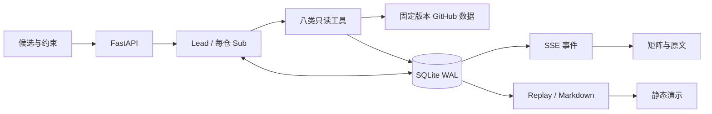

# 代码走读与学习练习

当前主流程是 RepoAudit 统一工作台。`evidence/agent.py` 的旧单仓循环和 `web/agent.js` / `web/evidence.js` 为历史兼容代码；新页面使用 `web/workbench.js`。

## 一条完整请求

以“Python 3.10 环境能否采用 Pydantic AI 或 Agno”为例：

1. `web/app.js` 将榜单卡片动作传给 `workbench.js` 的候选池；直接输入仓库也进入相同流程。
2. `start()` 为每个候选创建公开快照。`phase1_api.py → github_client.py` 读取默认分支提交，后续文件绑定该完整 SHA。
3. `POST /api/audit/sessions` 保存统一问题和快照绑定，`harness_api.schedule()` 获取执行租约，再启动异步 `Harness.run()`。
4. `routing.py` 先确定路由并落盘：单仓部署模式的单一版本、协议或指定配置核查跳过两个 Lead 调用，其余由 Lead 拆解共同约束。每仓 Sub 使用独立上下文与固定版本；架构和安全模式先运行对应扫描工具，共有八类取证工具。
5. `AuditTools` 获取目录/索引/片段；`AuditDB` 保存不可变证据。工具回执、检查点和事件以事务提交，再供下一次模型请求使用。
6. `model_view()` 和 `fit_context()` 在请求预算内保留完整关键语句，明确省略范围；AST hint 自动定位参数及调用。Sub 提交判断和摘录，`guardrails.verify_verdict()` 验证会话归属、版本、哈希和原文，再校准四态；Lead 只接收紧凑结果。`report_v3.py` 组装证据绑定的图谱、线索和配置块。
7. SSE 订阅已持久化事件，页面刷新公开状态，渲染逐项矩阵；点引用从本会话读取原始证据。
8. 导出时 `replay.py` 打包公开事件、报告、原文和用量。静态页面使用相同渲染路径，导入前再次校验。

## 模块与设计理由

| 模块 | 职责与取舍 |
|---|---|
| `config.py` / `schemas.py` | 读取边界与严格证据契约；文件、目录、Issue 分型，避免把动态社区数据当成 commit 内容 |
| `github_client.py` | HTTPX 异步访问，固定树/文件、限流/超时/重试、缓存；不执行仓库代码 |
| `tools.py` / `analysis_v3.py` | 六类基础工具加架构、安全分析；AST 参数与调用索引，24目录/24文件/1MiB 有界扫描，其他语言输出规则线索 |
| `routing.py` / `report_v3.py` | 确定性轻量路由、扩展报告引用与配置语法校验 |
| `workflows.json` / `workflows.py` | 实时接口与静态页面共用三种场景模板 |
| `db.py` | WAL、短事务、不可变产物、缓存与旧库迁移 |
| `agent_harness.py` | Lead/Sub 状态机；每仓上下文独立，当前按仓顺序执行，便于预算和恢复 |
| `harness_store.py` | 执行租约、检查点、幂等回执、事件、模型用量；外部调用与数据库事务分开 |
| `guardrails.py` | 参数/预算/去重及引用身份、摘录校验；语义是否成立另由评测与原文复核 |
| `harness_api.py` / `replay.py` | 会话命令、SSE、历史、证据、导出与包校验；订阅事件不重复启动任务 |
| `web/workbench.js` | 候选、实时/回放、矩阵、原文、追问；文本用 `textContent` 展示 |
| `eval/run_eval.py` | 冻结输入、离线契约、在线模型、全文基线与 Rubric 评分 |
| `ops/scripts/` | 热门采集、静态构建、一命令启动；原有榜单保留 |

## 两个走读案例

**缓存命中：**相同 `(repo, commit, path)` 再读文件，客户端直接使用 SQLite 缓存及原抓取时间；当前模型上下文若已看过完整区间，护栏返回证据提示。新追问有新上下文，仍须按需加载原文，因此缓存命中与上下文去重是两个指标。

**读取失败：**GitHub 限流或超时会成为带分类的工具错误与覆盖缺口；目录不完整不能推断文件不存在。模型可按预算换路径补查，否则输出 UNVERIFIED。已持久化的证据可在恢复后复用；响应尚未落盘的模型调用标为未知，不能声称完全无重复计费。

## 按阶段学习

| 阶段 | 关键入口 | 修改练习 | 复现 |
|---|---|---|---|
| 1 取证 | `tools.py`, `tests/test_phase1.py` | 给 Markdown fixture 加一个代码围栏内的伪标题，验证索引不误识别、原始行号保持正确 | `.venv/bin/python -m unittest discover -s tests -p test_phase1.py -v` |
| 2 编排 | `agent_harness.py`, `tests/test_harness.py` | 将一条冻结引用改成别仓证据，预测降级和原因后运行测试 | `.venv/bin/python -m unittest discover -s tests -p test_harness.py -v` |
| 3 页面 | `workbench.js`, `tests/test_workbench.js` | 给轨迹增加一个公开阶段中文标签，验证晚到响应不会覆盖新会话 | `node --test tests/test_workbench.js` |
| 4 评测 | `eval/golden_cases.json`, `run_eval.py` | 新增一个“只有 README 宣传、没有实现证据”的样本，先写期望与原文契约，再离线验证 | `.venv/bin/python eval/run_eval.py` |

推荐先完整演示一次，再沿证据按钮反查 API、数据库和工具，最后读模型循环。学习时用独立 fixture 改动；在线评测需显式启用，会产生模型费用。

## v3 的四个学习切片

| 阶段 | 设计问题与练习 | 离线复现 |
|---|---|---|
| V3-1 取证 | 在 fixture 中把 `base_url` 调用改为跨行并使用别名，检查 AST 完整语句范围，解释为何固定前后行不能保证完整 | `.venv/bin/python -m unittest discover -s tests -p test_v3_tools.py -v` |
| V3-2 编排 | 给单仓 Python 版本问题加 Docker 条件，观察快速路由变为完整流程；解释当前请求已读与数据库已缓存的差别 | `.venv/bin/python -m unittest discover -s tests -p test_v3_harness.py -v` |
| V3-3 表达 | 改回放中的图边并重算外层 Hash，观察底层关系校验仍拒绝载入 | `.venv/bin/python -m unittest discover -s tests -p test_v3_reports.py -v` |
| V3-4 实测 | 用原始记录核算一个有效配对的总 Tokens，核对报告分母与首次失败 | `.venv/bin/python eval/summarize_v3.py` |

安全工具读到进程调用、环境变量或 URL 后，还需追查输入来源、传播和调用条件；目录扫描不完整时不能宣称全仓安全。练习修改测试 fixture，保留真实录制原文件。
