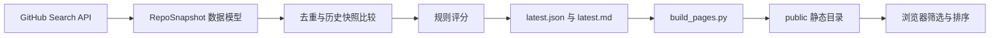

# 代码结构与学习路线

## 先理解一条数据流

R1 使用 FastAPI 同源提供构建产物和证据 API；原有榜单筛选仍在浏览器内执行。

## 文件地图

| 路径 | 职责 | 首先关注 |
| --- | --- | --- |
| `ops/scripts/github_hot_monitor.py` | API 采集、快照、评分、报告与命令行 | `cli` → `build_queries` → `collect_repositories` → `generate_rank_rows` |
| `ops/scripts/build_pages.py` | 复制网页，补充统计，生成 public | `cli`、`enrich_payload` |
| `data/snapshots/` | 历次原始仓库指标 | captured_at、queries、repos |
| `data/reports/` | 排名结果与 Markdown；latest 是最近结果 | rows、leaderboards、previous_snapshot |
| `web/index.html` | 页面布局与卡片模板 | repoCardTemplate、筛选器、榜单区域 |
| `web/app.js` | 读取 JSON、状态、筛选、排序、渲染 | `main` → `loadPayload` → `renderRows` |
| `web/styles.css` | 样式、布局、动画 | 卡片、筛选区、响应式样式 |
| `tests/test_hot_monitor.py` | 六项计算与报告测试 | 固定输入、预期输出、时间边界 |
| `.github/workflows/pages.yml` | 定时扫描、提交数据、构建并发布 | scan-build-deploy；已加入 Python 与前端测试，远端待推送后运行 |

## 六次学习练习

### 1. 从页面反查数据

打开 `data/reports/latest.json`，选择一个仓库，在页面搜索它。找到仓库名、stars、velocity 在 JSON 和 DOM 中的对应关系。

完成标准：解释为什么 JSON 有 181 项，初始页面只渲染 120 张卡片；为什么搜索不需要重新调用 GitHub。

### 2. API 与数据建模

读 `RepoSnapshot.from_api`、`GitHubClient._request_json`、`build_queries`、`dedupe_repos`。用隔离的 state-dir 跑一次小查询。

完成标准：说清外部 JSON 如何转成内部数据模型、为什么要去重、兜底查询怎样改变候选范围。

### 3. 历史状态与评分

读 `load_latest_snapshot`、`velocity_stars_per_day` 和三个 score 函数。

手算：100 星增长到 120 星，间隔两天，速度为 10 stars/day；间隔不足两小时返回 0。综合分是 45% interesting + 30% advanced + 25% productive。

完成标准：能区分热度指标、规则推断和技术适用性；知道缺少旧快照时速度 0 的具体含义。

### 4. 前端状态与小修复

读 `state`、`bindEvents`、`applyFilters`、`sortRows`、`renderSpotlight`。

已修复焦点卡片对应指标的显示；前端测试使用不同指标和零分样本验证。

完成标准：能解释“排序依据”和“显示数值”如何保持一致。

### 5. 失败路径与测试

读 `collect_repositories` 的异常处理和现有 unittest。

待实施练习：覆盖部分查询失败、全部失败、重复仓库与缺少历史记录；报告中显式保存采集完整性，避免部分结果看起来像完整结果。

完成标准：测试验证用户可观察的行为，并说明失败后输出什么。

### 6. 首条研究流程

走读已实现的 R1/R2，在一个仓库上复现证据读取和模型报告。

完成标准：能逐步演示输入 URL、工具读取、证据保存、模型输出、引用跳转；能展示资料缺失时的处理。

## 已识别的改造前问题

- 候选默认只检索近 30 天新建仓库，容易漏掉成熟项目；研究功能需要独立的候选检索策略。
- topic 查询后有宽泛兜底查询，用户选择 agent 不代表结果全部相关。
- 部分查询失败只打印警告，报告缺少完整性标记。
- 前端匹配数与 120 张渲染上限容易混淆，后续补分页或明确提示。
- 焦点卡片专项分显示问题已修复并增加前端回归。
- 评分基于关键词与元数据，技术选型需要增加需求约束、文档证据和明确的评价标准。

其余条目仍是后续改进方向。

## R1 证据读取数据流

1. `web/evidence.js` 将输入提交给 `POST /api/snapshots`。`evidence/app.py` 校验仓库名或 GitHub URL，读取公开仓库元数据和默认分支当前 commit，将仓库、完整 SHA 和创建时间写入 SQLite，返回快照 ID。
2. 页面请求 `GET /api/snapshots/{id}/tree?path=`。服务按 commit 查询根树；进入子目录时使用父树条目的 tree SHA 逐层查询。返回目录、抓取时间和 `truncated`。页面提示不完整的目录，不能将缺项当作不存在。
3. `GET /api/snapshots/{id}/fragment?path=README.md&start=1&lines=200` 查固定树中的普通文件，校验路径、模式和 512 KiB 文件大小，再读取 blob，检查 UTF-8、二进制和大小，计算完整文件 SHA-256。接口返回原文片段、行号、抓取时间、缓存状态和固定版本链接；单次最多 200 行、16 KiB。行号按 LF 计算；字节限制优先保留完整行。
4. 页面用 `textContent` 展示原文。超长行返回前缀并标记 `partial_line`，页面提供来源；其他截断可从下一行继续。快速选择文件时请求序号防止旧响应覆盖新卡片。

### 缓存命中和失败走读

`cached()` 按 `(仓库, commit, 类型, 路径)` 查询 SQLite：首次成功读取后保存文件或目录及抓取时间；再次读取同版本命中缓存，返回原始抓取时间和 `cache_hit=true`，不再请求该对象。新快照指向相同 commit 时也可复用。失败不会写缓存；GitHub 404、限流和网络超时分别返回明确错误，超时和服务端 5xx 最多请求三次。

### 动手练习：验证片段边界

运行 `node --test tests/test_frontend.js` 和 `.venv/bin/python -m unittest discover -s tests -v`，阅读 `test_preserves_complete_lines_before_byte_limit`。把测试中的第一行换成另一段短文本并更新预期，重新运行；解释超长第二行为什么需要 `partial_line`，以及为什么不能直接跳到第三行。完成后还原练习修改。

## R1.1 阅读状态与证据身份

新提交先清空视图并递增 generation；每个目录和文件请求捕获自己的快照，响应和按钮仅在所属快照仍是当前快照时生效，目录、文件各自还有请求序号。读取失败保留清楚的重试入口。静态模式先检查能力接口，非 JSON 和断网均按服务状态处理。

`FragmentResponse` 对空文件返回 `empty=true`、空文本及两个 null 行号；来源无行锚点。其他片段以原始 LF 行范围标识，`content_sha256` 是整个文件字节的 SHA-256，`fragment_sha256` 是返回文本的 UTF-8 字节哈希。`evidence_id` 以规范 JSON 编码的仓库（小写）、commit、路径、原始行范围、`partial_line`、`empty` 和片段哈希为输入，SHA-256 加 `ev_` 前缀；不含随机快照 ID、抓取时间或缓存命中状态。它用于确认片段身份，引用是否支持结论需要另行判断。

前端每次真正请求成功后保存片段访问历史；上一段返回实际访问片段，下一段优先访问已有历史，或按当前完整末行继续。跳转后从当前位置分叉历史；超长单行不提供跳到后续行的按钮。常用文件按钮只根据已读取目录建立。

练习：在真实仓库 README 跳到第 20 行，再回到上一段；比较两个片段的证据 ID 与完整文件 Hash，并解释为何文件 Hash 相同而片段 ID 不同。

## R2 最小 Agent 数据流

`web/agent.js` 提交仓库与要求到 `POST /api/agent/runs`，随后轮询任务状态。`evidence/agent.py` 的 `execute()` 先创建固定提交快照，再调用 Responses API；模型提出 `list_directory` 或 `read_fragment` 时，由 `tool_call()` 校验参数并复用 R1 读取逻辑。工具结果与模型输出（包括 reasoning 项）进入下一次请求，直到生成结构化报告或触及预算。

`validate_rows()` 逐项检查要求 ID 和本次登记的证据 ID，无效引用或没有引用的支持/冲突判断会降级为信息不足。前端通过 `textContent` 展示结果，并从服务端证据记录生成来源链接。SQLite 保存证据缓存，核查任务状态保留在当前服务进程内；重启后需要重新核查。

练习：阅读 `tests/test_agent.py` 的无效引用用例，分别给模型结果设置一个已登记 ID、未知 ID 和空引用，预测判断如何变化后运行 `.venv/bin/python -m unittest discover -s tests -p test_agent.py -v`。解释为什么合法 ID 仍不能证明结论得到原文支持。
