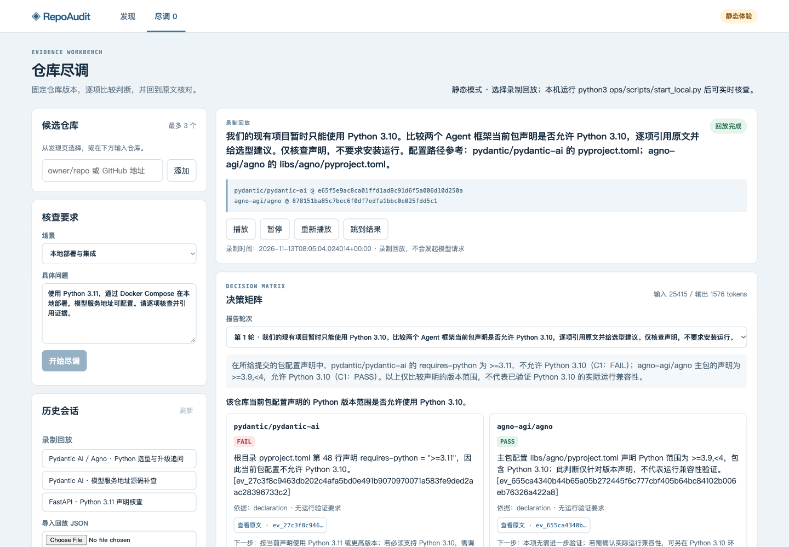

# RepoAudit-Agent 交付现状与验收

日期：2026-11-13。**SDD 调整后四阶段的演示闭环已交付：发现 → 候选 → 约束核查 → 多仓矩阵 → 原文 → 追问 → 导出 → 静态回放。** 本地提交与版本标签 `repoaudit-demo-2026-11-13` 固化此版，详见 [版本基线](RELEASE_BASELINE.md)；尚未推送或更新线上 Pages。

## 解决什么需求

开发者引入开源 Agent 框架时，要反复翻阅 README、包声明、容器配置、源码入口和社区反馈，才能确认它是否适合现有环境。RepoAudit 将具体条件变成逐项判断，并保留对应版本的证据，帮助用户决定先试哪个仓库、需要升级什么环境、还有哪些问题需补查。

本次真实演示给出了可行动的选型差异：同样要求 Python 3.10，所核查版本的 Pydantic AI 声明最低 3.11，Agno 声明 >=3.9,<4；因此前者 FAIL、后者 PASS。用户追问“升级至 3.11 后呢”，系统在相同提交上重新核查，两者均 PASS。这个结论针对包声明，安装与业务运行另行验证。

## 已实现的架构与技术

Python 3.11 + FastAPI + Pydantic v2 + HTTPX + SQLite WAL + OpenAI Responses / Function Calling + 原生 HTML/CSS/JavaScript；运行模型为 gpt-6.1-sol / low。

| 能力 | 当前交付 |
|---|---|
| 统一产品流程 | 热门发现、搜索、卡片入口、最多 3 个候选、直接输入 URL、场景/自定义问题、矩阵、证据、历史和追问 |
| Lead / Sub | Lead 产生每仓可独立判断的共同约束；每仓独立模型上下文；原始产物外置，Lead 收紧凑结果；当前按仓顺序执行 |
| 六类取证 | 概览/树、Markdown/Python AST/行块索引、按行切片、依赖环境、部署配置、Issue 与评论；均为只读 |
| 上下文治理 | 超过 150 行先索引；文件最多 512 KiB，切片最多 120 行/6,000 字符；模型视图有界、显式省略；当前上下文区间去重 |
| 证据与护栏 | 固定 commit、原始行号、哈希和来源；会话/仓库/版本/原文摘录校验；非法路径、二进制、超限和预算限制 |
| 持久化恢复 | WAL 检查点、执行租约、工具回执、公开事件及用量；历史恢复、刷新恢复和新上下文追问 |
| 实时/分享 | SSE 订阅持久化事件；Markdown 报告、自包含 Replay；播放/暂停/跳转、报告轮次选择、原文抽屉 |
| 评测与构建 | 16 个冻结契约、13 个在线判定用例、全文基线、实际费用估算；CI 免费测试、静态构建和回放打包 |

证据存在与哈希一致证明来源完整性；结论语义由原文复核与评测另行判断。SSE 展示公开计划和执行动作，不导出隐藏推理。

## 四阶段验收

| 阶段 | 结果 | 依据 |
|---|---|---|
| Phase 1 证据与工具 | 通过 | [六工具与缓存验收](PHASE1_VALIDATION.md) |
| Phase 2 编排、恢复、护栏 | 通过 | [编排验收](PHASE2_VALIDATION.md)、实际进程退出恢复 |
| Phase 3 工作台与回放 | 通过 | [页面与接口验收](PHASE3_VALIDATION.md)、本次实时/静态浏览器操作 |
| Phase 4 案例与评测交付 | 完成 | [评测报告](../../eval/eval_report.md)、[三份真实记录](examples/manifest.json) |

独立复跑：**Python 94/94、前端 13/13、离线冻结契约 16/16**；静态构建和差异检查通过。进程故障测试以退出码 77 中断，验证有效租约内不重复执行、租约到期恢复、已提交工具调用不重复。

浏览器完成双仓输入与真实模型运行、SSE 自动终态、原文与 GitHub 固定行跳转、追问、历史重开、静态回放及报告轮次切换。390px 视口的页面与内容宽度均为 390px。静态模式禁用实时提交，回放无模型请求。导出的全部文件片段已对本地冻结原文核对行范围、完整文件与片段哈希。

验收中修复了终态漏刷新、旧响应覆盖、品牌重复监听、执行权过期后的恢复入口、跨仓任务错误下放及历史报告不可切换等问题。

## 真实案例与交付物

1. **Pydantic AI / Agno · Python 选型与升级追问**：Python 3.10 时 FAIL/PASS，追问 3.11 时 PASS/PASS；两轮共 18 次模型、10 次工具调用，26,991 tokens。追问 4 次工具均命中缓存。文件版本：Pydantic AI `e65f5e9ac8ca01ffd1ad8c91d6f5a006d10d250a`；Agno `878151ba85c7bec6f0df7edfa1bbc0e025fdd5c1`。
2. **Pydantic AI · 模型服务地址源码补查**：首轮因构造调用未进入模型摘录而 UNVERIFIED；用户指定第 225 行并收窄到参数转交后，引用整行确认 `base_url` 传给 `_create_openai_client`。保留两轮记录，展示缺口与补查，没有将参数转交扩大为远端服务兼容性结论。
3. **FastAPI · Python 3.11 声明核查**：较早真实案例，固定 `5add7a458d629b07311d48261f696b5ac2bb9a5f`，引用包声明与 `.python-version`；保留当时预算停止提示。

[案例与用量清单](examples/manifest.json) · [双仓 Markdown 报告](examples/agents-python-comparison.md) · [模型配置报告](examples/pydantic-model-endpoint.md)。三份原始回放在 `web/replays/`，均来自真实持久化会话。

## 评测的实际结果

最终版本首轮在线测试 **11/13** 同时满足状态与关键证据契约；16 个固定案例是明确标注的构造样本，另存真实仓库选取文件与回放。

- A2 在最终汇总时网络中断。利用同一检查点恢复后获得 PASS，未增加模型调用；保留 1 次未知调用记录。首轮分母仍计失败，恢复结果单列在 [recovery_results.json](../../eval/recovery_results.json)。
- C3 缺少授权文本，正文表示“无法确定”，状态却给 FAIL，未符合 UNVERIFIED 预期。这是当前四态语义仍需改善的实际案例。
- 12 个可配对小样本：Agent 全流程 64,691 tokens，全文单轮基线 23,870 tokens，前者约为后者 2.71 倍；没有观察到 Token 降本。完整基线与历次协议修正保留在 [eval/](../../eval/README.md)。

## 当前交付边界与后续优先级

这版可作为本地真实运行和静态回放的简历项目。最值得下一步改进的三点，均来自实际验收：

1. 固定 PASS/FAIL/UNVERIFIED 的业务含义，增加“资料不存在”与“明确不满足”的对照样本，优先修正 C3 这类标签错误。
2. 让有界摘录保留更完整的关键调用行，并引导自动补查，减少模型配置案例中用户指定行号的需要。
3. 简单单仓约束跳过不必要的规划/汇总，使用同一评测协议衡量质量与总费用；只有实测改善后再写降本指标。

恢复依赖已提交边界；旧租约最长约 180 秒，模型响应未落盘时可能再次调用。当前不执行候选仓库代码，因此容器能否启动、本地模型功能兼容仍由运行测试确认。多租户权限、生产运维和分布式调度不属于本次演示交付。达到当前闭环后停止扩展，后续按真实使用反馈选择一项改进。

运行和演示步骤见 [DELIVERY_GUIDE.md](DELIVERY_GUIDE.md)，简历表达见 [RESUME_PROJECT.md](RESUME_PROJECT.md)。
