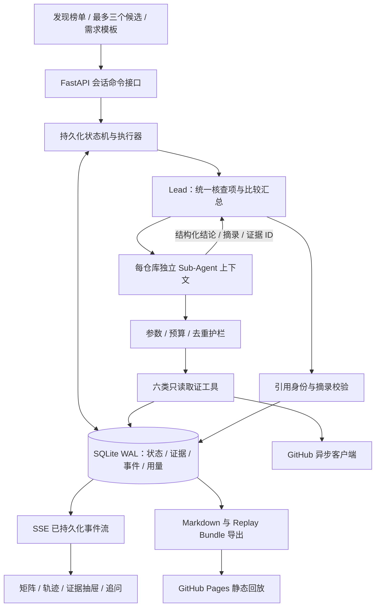

# RepoAudit-Agent v2｜改造执行计划

日期：2026-11-13（Asia/Shanghai）
状态：Phase 1～4 的演示交付已完成；最终状态和实测缺口见 [DELIVERY_STATUS.md](DELIVERY_STATUS.md)。
设计来源：[SDD v2.0 原文抽离版](REPOAUDIT_SDD_V2_SOURCE.md)。本文是结合现有代码形成的执行版本；技术勘误优先于来源文档中的冲突条款。当前状态入口为 [README.md](README.md)。

## 1. 改造目标与用户任务

将“热门榜单 + 独立阅读器 + 单仓核查表”改造为 **RepoAudit-Agent：开源项目架构尽调与多仓库选型工作台**。

目标用户：准备引入开源 AI / Agent 项目的开发者。核心任务是从 1～3 个候选仓库中，依据自己的部署与集成约束，查清文档声明、依赖清单、部署配置、源码入口及社区问题之间是否一致，决定先试哪个项目、还需要验证什么。

贯穿四阶段的主验收场景：

> 从榜单选两个候选 Agent 项目，或直接粘贴仓库地址；输入“使用 Python 3.11，通过 Docker Compose 在本地部署，模型服务地址可配置”。系统拆解同一套核查项，分别取证，展示逐项比较矩阵；点击任何结论可查看对应仓库和版本的原文。用户可追问模型服务的实际配置位置、在服务重启后继续任务，并将报告和回放包分享给他人查看。

次级模板保留“协议条款与依赖声明核查”“Issue 与维护风险线索”。这些模板输出来源、具体条款或反馈与待核实事项；没有漏洞数据库、动态执行或专业法律评审时，不输出“安全合规已通过”的总承诺。

交付形态：本机一条启动命令进入实时工作台；GitHub Pages 免安装打开真实运行的静态回放。首屏从发现、候选池、需求到结果形成连续流程。

## 2. 当前代码如何处理

| 现有部分 | 处理方式 |
| --- | --- |
| `ops/scripts/github_hot_monitor.py`、快照数据与评分 | 保留作为发现入口；本轮不重写热度算法 |
| `evidence/app.py` 的固定提交、路径与大小限制、SQLite 缓存 | 提取到新模块并复用，保留旧 API 适配直到新工作台切换完成 |
| `evidence/agent.py` 的 Responses 调用、引用校验、预算与错误分类 | 迁移为模型适配、护栏与 harness；用持久化状态机替换内存 JOBS |
| `web/evidence.js` 的原始行号、文本安全展示、来源与 Hash | 复用为证据抽屉；不再作为平行的独立主流程 |
| `web/app.js`、榜单卡片 | 增加立即尽调、加入对比和选中状态；保留搜索与榜单切换 |
| `web/agent.js` | 改为工作台、SSE、历史会话、追问、报告和回放的统一渲染 |
| 29 项 Python、6 项前端测试 | 保留作已交付原型基线；新能力补充相应契约和故障测试 |
| 已修复焦点卡片专项分、已接入 CI 测试 | 不重复作为新功能开发，继续回归 |
| `build_pages.py` | 已支持递归复制 web 子目录；验证回放包确实进入产物，按实际缺口修改 |

迁移在当前 checkout 中逐阶段进行。Phase 1 先增加可验证的新模块与兼容适配，不同时删除旧入口。每阶段验收记录写明具体代码、命令与结果；旧实现退场以新流程通过验收为条件。

## 3. 目标架构与技术栈

保持 Python 3.11、FastAPI、Pydantic v2、HTTPX、SQLite WAL、原生 HTML/CSS/JS。复用 OpenAI Responses API，运行模型与推理强度沿用本机配置；编码会话和运行时模型配置分开管理。

Lead 和 Sub 是应用中的独立模型上下文与任务角色。一个 FastAPI 进程内使用异步任务执行，不引入 Actor 分布式运行时。当前 Sub 按仓顺序执行，最多处理 3 个仓库；SQLite 使用短事务和明确的连接归属，阻塞数据库操作放入受控线程，网络等待不持有写事务。

目录采用来源 SDD 第 3 节结构。`agent_harness.py` 管状态机及角色上下文，`github_client.py` 统一外部访问，`tools.py` 返回结构化事实和证据。工具不直接生成最终选型结论。

## 4. 实施前统一的契约与勘误

### 4.1 判断、来源和指标

1. `PASS / RISK / FAIL / UNVERIFIED` 表示某个明确核查项的证据结论。每项同时记录 `verification_basis`（如 `declaration`、`static_config`、`community_report`）和 `runtime_validation_required`，保留原型对“需要运行验证”的区分。
2. 文档缺少 Dockerfile、依赖旧 SDK、只找到 OpenAI 依赖，不直接等于不支持 Docker / Ollama。必须核对完整性、替代配置、实际调用入口和明确的约束冲突；目录截断、解析失败、API 限流都属于覆盖缺口。
3. 引用 ID、仓库、commit 与 Hash 校验验证来源身份，不能验证结论语义正确。逐字摘录必须来自有效片段；语义支持由冻结案例标签、Evidence-Only 评分和真实案例复核单独评价。
4. SHA-256 称为“内容哈希”，不称为数字签名。正文引用与结构化引用必须一致；任一引用失效时保守降级受影响核查项，不能只删除无效 ID 后原样保留强断言。
5. 原文中的“30%+”“35%～55%”“约 150 tokens”和“100%”均不预填为成果。指标记录分母、测试样本、模型配置及原始用量；没有对应基线时节省值为 null。

### 4.2 固定版本与 Issue 证据

- 仓库文件固定到首次会话快照的完整 commit SHA；追问与恢复沿用该版本。刷新版本应新建会话，避免同一矩阵混合两个版本。
- 星标数、维护状态、Issues 和评论是抓取时的信息，不属于 commit 快照。保存 `fetched_at`、Issue / comment ID、`updated_at`、正文 Hash 和来源 URL。
- 为 Issue 使用单独的证据 Schema：`observed_against_commit` 只说明调查时的文件版本，不声称 Issue 与该版本严格对应。评论编辑后的网页可能变化，以导出包中保存的原文和抓取时间复核。
- 依赖摘要和部署摘要必须指向底层文件证据；Issue 反馈标注为社区报告，不能单凭标题断定缺陷在当前版本仍存在。

### 4.3 文件、大纲和去重

- 闭区间行数为 `end_line - start_line + 1`，合法范围 `1 <= start_line <= end_line`，单次不超过 120 行 / 6,000 个 Unicode 字符。继承 512 KiB 文件读取上限、二进制及路径限制。
- 非法起始行拒绝并返回明确错误；超过片段上限只返回真实范围并标记截断。空文件保留无行号语义，不能伪造 `1–0`。
- Markdown 大纲在原始文本上定位，识别代码围栏，过滤展示噪音时不改变原始行号。大纲不完整时给出覆盖范围与继续读取入口。
- 第二工具保留 `get_markdown_outline` 入口，内部支持按文件类型分派：Markdown 标题、Python AST 定义范围；其他语言先提供明确标注的行块索引。不得将行块索引宣称为 AST 解析，也不执行仓库源码。
- 大于 150 行文件的首次模型读取先取得大纲，配置工具的确定性解析也要限制返回大小。服务端可以为生成索引读取文件，模型只收到索引或选中片段。
- 证据池按会话复用；“已注入原文”的去重范围必须包含 `context_id`。同一上下文重复请求相同或已覆盖区间返回引用提示；新的 Sub / 追问上下文需要原文时，从本地证据池按需加载。不能因旧上下文曾读过就让新上下文只剩无法理解的 ID。
- 对部分重叠区间只补缺口，记录原文注入量与去重状态。缓存命中、模型上下文去重分别计数。

### 4.4 工具边界与提示词注入

- Sub-Agent 绑定 `session_id + repo + commit`，模型提供的 repo 参数必须与绑定对象一致；跨仓库、任意 URL、路径穿越均拒绝。
- 外部内容作为不可信数据封装，保留原始证据，转义封装标记，避免伪造边界。标签是输入分隔手段，不是能证明“防注入成功”的安全边界。
- 模型只拥有六类只读工具；不授予 shell、网络任意地址、配置修改、读取本机密钥等能力。`setup.py`、Makefile、Dockerfile 只解析，不执行；YAML / 配置解析器不得执行构造器或代码。
- 每个聚合工具限制实际读取数量：初始最多解析 8 个相关文件；Issue 初始最多返回 5 条、每条最多 3 条评论，超过部分明确标注。内部请求、重试、字节和耗时同样纳入预算，不能用一个工具名称隐藏无限抓取。
- 初始模型预算：单仓最多 6 次模型请求（含最后报告轮）、8 次工具调用；Lead 最多 2 次模型请求；1～3 仓总预算独立控制。每次预留输出、累计实际 usage，错误和重复调用同样计数，预算耗尽保留证据并输出缺口。
- SSE 与回放展示公开计划、状态、工具动作、来源和结论摘要，不读取或导出模型隐藏推理内容。

### 4.5 数据库与持久化

- 新运行库使用 `.evidence-data/audit_engine.db`，不放入会被 Actions `git add data` 自动提交的 `data/`。DB、WAL、SHM、凭证和原始运行日志全部忽略提交。
- 保留原库 `.evidence-data/evidence.sqlite3`；提供带 schema version 的增量迁移或缓存导入，先备份并核对数量及 Hash，不删除历史文件。
- 五张业务表保留。另明确持久化 `audit_events`（SSE 事件序号和 payload）、`model_calls`（角色、请求状态、实际 usage、模型与耗时），不能把事件与模型用量只存内存。
- 主键使用完整版本标识或 UUID；证据继续采用内容身份 Hash 生成 ID，短码仅用于界面。`repo@sha[:12]` 不用作唯一性依据。
- 会话增加 `revision`、`turn_id`、执行 lease / owner、待执行操作与最近已提交工具调用标识；统一状态枚举 `INIT / PLANNING / INVESTIGATING / SYNTHESIZING / VERIFYING / COMPLETED / INTERRUPTED / FAILED`。
- 证据、工具结果、进度事件与相应 Checkpoint 在同一事务提交；网络请求在事务外。重启时恢复未终结会话为可恢复状态，已提交子任务不重跑。
- 恢复承诺以“已提交的执行边界”为准。外部模型请求成功但本地尚未落盘时，供应商是否已经计费可能未知；记录为 unknown，恢复时说明可能重新请求，不承诺跨外部 API 的 exactly-once 或零重复计费。WAL 本身不等于无损恢复。

### 4.6 API、SSE 和回放

统一路由前缀为 `/api/audit/sessions`，取消来源文档中 `/api/audit/stream` 和缺少 `/sessions` 的恢复路径歧义。

| 接口 | 语义 |
| --- | --- |
| `GET /api/health` | 服务与能力检测，返回可用功能，不返回凭证 |
| `POST /api/audit/sessions` | 原子创建并安排执行，支持幂等键，返回 session_id |
| `GET /api/audit/sessions` | 会话历史与状态 |
| `GET /api/audit/sessions/{id}` | 当前阶段、报告及恢复信息 |
| `GET /api/audit/sessions/{id}/stream` | 订阅持久化事件，不启动或重跑任务 |
| `POST /api/audit/sessions/{id}/resume` | 获取执行权并继续已中断任务；重复调用不创建第二个执行器 |
| `POST /api/audit/sessions/{id}/followup` | 基于固定快照创建新 turn，复用证据，保留旧报告版本 |
| `GET /api/audit/sessions/{id}/evidence/{evidence_id}` | 返回该会话有权引用的证据原文 |
| `GET /api/audit/sessions/{id}/export?format=markdown|replay` | 导出报告或自包含回放包 |

- SSE 使用持久化递增 event ID；支持 `Last-Event-ID` 和显式 `after` 游标、心跳、错误与结束事件。浏览器重连只补发遗漏事件，客户端按 ID 去重。
- 断开 SSE 不自动杀死后台任务；重复连接、多个标签页不得造成重复模型请求。恢复与追问不能同时修改同一会话，状态冲突返回清晰结果。
- 回放包包含 `schema_version`、模型配置摘要、来源与抓取时间、固定快照、公开事件、证据、报告、用量与包内容 Hash；导入时校验 Schema、大小、引用关系和内容 Hash。
- Live 和 Replay 复用同一套事件渲染器；Replay 显示“录制回放”、录制时间与仓库版本，不模拟成正在发起真实尽调。断网环境也可打开证据原文，不要求再请求 GitHub。
- 静态回放不承诺实时追问；预录追问必须明确标注，实时输入只在可用后端模式启用。

## 5. 四阶段实施与验收

### Phase 1：持久化证据底座与六类工具

**交付：**`config.py`、`schemas.py`、`db.py`、`github_client.py`、`tools.py` 和旧路由适配。配置明确 Pydantic v2 版本范围，优先标准库 TOML / JSON / AST；YAML 等解析依赖按实际需要明确加入并固定可复现版本。

六类工具全部落地：仓库概览 / 文件大纲 / 行区间读取 / 环境依赖 / 部署配置 / Issue 风险线索。依赖工具覆盖声明清单并按存在情况读取 Python、npm/pnpm/yarn 等锁文件，无法确定性解析的内容返回明确状态。每个工具返回统一证据、覆盖范围、截断、错误与缓存信息。

**验收：**固定快照中依次查看大纲、读取一节、提取依赖和部署配置、检索冻结 Issue；每个事实能回到原始证据。重启后快照和证据可读；同版本读取命中缓存。测试覆盖围栏内伪标题、单行与空文件、中文字符截断、目录截断、恶意路径、二进制、限流、分页、解析失败与缓存迁移。实际 GitHub 连通检查与离线 Fixture 分别记录。

**停止点：**六工具可被自动化调用，原型页面仍可运行；不提前把尚未接入的 Lead-Sub 或恢复写成完成。

### Phase 2：Lead-Sub、上下文治理、Checkpointer 与护栏

**交付：**`guardrails.py`、`agent_harness.py`、角色 Prompt、严格输入输出模型。Lead 生成同一套核查项；各 Sub 拥有独立输入历史和仓库绑定；完成后只有结论、必要摘录、证据 ID 与缺口进入 Lead，原始全文存储在证据库和受限 Checkpoint 中。

在每个可恢复边界落盘预算、上下文标识、工具调用状态、已完成仓库、证据引用和报告版本。运行完成后释放 Sub 活跃上下文；恢复和追问按需重建，避免全量历史回灌。

**验收：**两个仓库中一个提供可配置模型服务地址，另一个只有 README 声明，产生可解释的差异矩阵。断点故障测试至少覆盖：完成一仓后重启、工具结果提交后重启、模型响应落盘前中断、重复 resume、上下文去重、追问重用证据、跨仓引用和 Hash 篡改。确认已提交步骤不重跑，未完成部分能继续，Lead 请求不包含 Sub 的全部原文。

注入样本测试分开检查“工具能力未越界”和“结论是否被诱导”，不能只因外部文本被标签包裹就算通过。

### Phase 3：统一工作台、SSE、历史追问与导出

**交付：**发现页与尽调页双视图，卡片立即尽调 / 加入对比，最多 3 仓候选池，自定义需求和三个预设。持久化会话历史、SSE 轨迹、矩阵、证据抽屉、恢复与追问、Markdown / Replay 导出、静态回放播放器。

补一个跨本地开发环境的启动入口（如 `ops/scripts/start_local.py`）：检查 Python / 配置、构建页面并启动服务；首次安装在 README 中集中说明，后续通过一条命令启动。模型调用只发生在服务端。

**验收：**从榜单卡片进入工作台不手工复制仓库；加入第 4 仓时明确提示；一份需求生成多仓矩阵；点击引用即看到原文。刷新页面能回到会话，SSE 断开重连不重复执行，服务重启后能从历史会话恢复。追问与导出可操作；手机宽度可阅读。断开后端后，静态站点可以加载回放、控制播放和查看证据，且无模型 API 请求。

浏览器验收以实际操作为准，增加覆盖 Agent 工作台的前端测试；现有 6 项前端测试主要覆盖榜单和 R1 阅读器，不能充当新工作台的验收。

### Phase 4：真实尽调案例、冻结评测与展示交付

**交付：**`golden_cases.json`、`fixtures/`、`run_eval.py`、实测 `eval_report.md`、2～3 份真实回放包、使用说明和项目经历。

- 16 个冻结案例按 A4 / B4 / C3 / D3 / E2 分类。每例记录 query、来源、固定文件版本、Issue 抓取版本、预期状态、支持证据与评分说明。
- 真实仓库冻结素材和人为构造的陷阱 / 注入样本分别标注；构造样本不得冒充真实项目缺陷。首批真实案例覆盖单仓部署核查、两个仓库横向比较、恢复后追问，最终选用同一任务领域且可比较的真实候选仓库。
- 确定性离线评测与在线模型评测分开：前者测 Schema、引用、Hash、去重、恢复和错误处理；后者测判断、取证覆盖及语义支持。冻结输入可保证离线输入一致，不能保证在线模型输出逐字确定。
- Baseline 与新 harness 使用相同模型、约束和冻结资料；记录 Lead、Sub、工具回合的全部输入 / 输出 / 缓存 tokens，以及质量得分、时延和失败，不只比较主干 tokens。资料截断或模型配置不同须单独标注。
- Evidence-Only Judge 使用冻结 Rubric 0/1/2、证据和人工期望，不靠模型自述评分；保存 Judge 模型、Prompt 和实际受支持的生成参数，不假设所有模型都支持 `temperature=0` 或因此完全确定。
- 指标包括引用有效率、语义支持得分、已定义陷阱检出率、缺证据诚实率、Schema 合格率、恢复结果、总 token / 成本。输出原始计数和失败案例；观察到零节省或负节省也照实记录。
- 运行真实评测前生成包含案例数、模型调用上限和费用预算的 manifest，在线预算明确后再执行；本次规划不调用收费模型。免费离线契约验证可先完成。

**验收：**新访客打开 GitHub Pages，无需安装和密钥即可完成回放、比较、证据查看；开发者按说明在本机完成实时同类任务并导出报告。评测可复现，回放源自真实记录，简历数字逐项链接到实测依据。达到这些条件后交付，不继续自动添加功能。

## 6. 第一轮实施交接

工作目录：`/Users/moon/Documents/ai agent/github-hot-monitor`。

阅读顺序：本计划 → 来源 SDD → 当前 `evidence/app.py`、`evidence/agent.py`、`tests/test_evidence.py`、`tests/test_agent.py`、`ops/scripts/build_pages.py`。

第一轮范围为 Phase 1。先冻结 Schema、证据来源类型和存储迁移策略，再实现六类工具及缓存测试，最后通过兼容适配接回现有读取入口。不要整文件推倒重写，也不要用预填证据或固定报告替代真实解析。

完成汇报必须包含：可复现的工具输入 / 输出示例、修改模块、测试命令与实际结果、已知未覆盖格式、迁移与旧入口是否正常。Phase 1 已通过主会话独立验收，实际结果与格式覆盖范围见 [PHASE1_VALIDATION.md](PHASE1_VALIDATION.md)。
